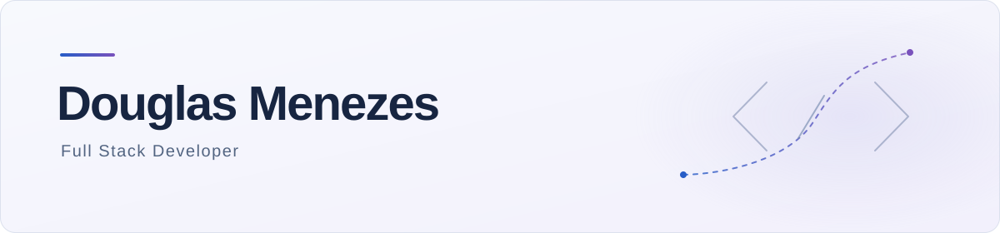

<picture>
  <source media="(prefers-color-scheme: dark)" srcset="./assets/profile-banner-dark.svg">
  <source media="(prefers-color-scheme: light)" srcset="./assets/profile-banner-light.svg">
  
</picture>

  <strong>PHP &amp; Laravel · Vue &amp; Nuxt · Web &amp; desktop applications</strong>

  <a href="https://douglasmenezes.dev.br">Portfolio</a> ·
  <a href="mailto:contato@douglasmenezes.dev.br">Contact</a> ·
  <a href="./README.pt-BR.md">Português (Brasil)</a>

## About me

Hi, I'm Douglas, a full stack developer based in **São Paulo, Brazil**. I build web platforms, APIs and desktop applications, connecting business workflows, integrations and user interfaces.

My core stack is **PHP, Laravel, Vue, Nuxt and TypeScript**. My work includes B2B applications, authentication, background processing and the modernization of existing systems.

I also have a degree in **Civil Aviation** and a **private pilot license**. That background shapes my interest in flight simulation, telemetry and operational tools.

## What I can help with

- **Web applications and APIs:** Laravel backends, REST APIs and business workflows.
- **Frontend development:** interfaces and dashboards with Vue, Nuxt, Quasar and TypeScript.
- **System integrations:** third-party APIs, authentication flows, queues and background jobs.
- **Desktop applications:** tools that connect web interfaces with native capabilities.
- **Existing systems:** maintenance, refactoring and modernization of PHP and JavaScript applications.

## Selected public projects

| Project | What it does |
| --- | --- |
| [**Veyra**](https://github.com/menezedouglas/veyra) | Experimental P2P desktop messenger exploring direct connections and ephemeral messaging. **Rust · Tauri · Vue** |
| [**ElegHTTP**](https://github.com/menezedouglas/ElegHTTP) | TypeScript library for class-based HTTP requests, with lifecycle hooks, error handling and download progress. **TypeScript · Fetch API** |
| [**php-docker**](https://github.com/menezedouglas/php-docker) | Configurable local PHP development environment with Apache, MySQL, Node.js and worker services. **Docker Compose · PHP** |

### Where software meets aviation

I'm also developing **FlySimOps**, an operations management platform for flight simulation pilots and virtual airlines, bringing together web tools and a desktop companion. It is an ongoing project that connects my development work with my aviation background.

## Technologies I work with

| Area | Technologies |
| --- | --- |
| Backend | PHP, Laravel, REST APIs |
| Frontend | JavaScript, TypeScript, Vue, Nuxt, Quasar, Tailwind CSS |
| Data | MySQL, MariaDB, PostgreSQL, Redis |
| Desktop | Electron; Rust and Tauri through Veyra |
| Environment and delivery | Docker, Linux, Nginx, Node.js, GitHub Actions |

## How I approach development

- Start with the business workflow and the needs of the people using the software.
- Keep responsibilities clear across services, APIs and interfaces.
- Use automated tests for critical behavior and make maintenance part of the design.
- Consider authentication, permissions and data handling throughout implementation.
- Document technical decisions and make setup and deployment understandable.

## Let's work together

Have an application to build, integrate or improve? Explore my [portfolio](https://douglasmenezes.dev.br) or get in touch at [contato@douglasmenezes.dev.br](mailto:contato@douglasmenezes.dev.br).
