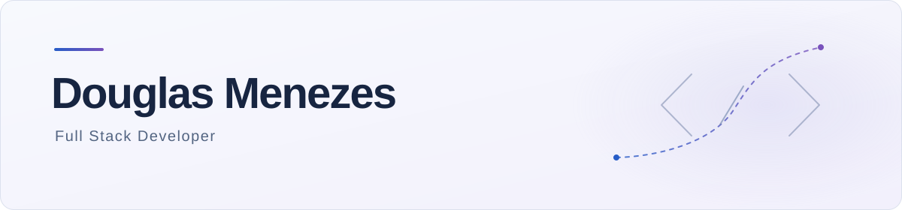

<picture>
  <source media="(prefers-color-scheme: dark)" srcset="./assets/profile-banner-dark.svg">
  <source media="(prefers-color-scheme: light)" srcset="./assets/profile-banner-light.svg">
  
</picture>

  <strong>PHP &amp; Laravel · Vue &amp; Nuxt · Aplicações web e desktop</strong>

  <a href="https://douglasmenezes.dev.br">Portfólio</a> ·
  <a href="mailto:contato@douglasmenezes.dev.br">Contato</a> ·
  <a href="./README.md">English</a>

## Sobre mim

Olá! Sou o Douglas, desenvolvedor full stack de **São Paulo, Brasil**. Desenvolvo plataformas web, APIs e aplicações desktop, conectando regras de negócio, integrações e interfaces.

Minha stack principal é **PHP, Laravel, Vue, Nuxt e TypeScript**. Minha atuação inclui aplicações B2B, autenticação, processamento em segundo plano e modernização de sistemas existentes.

Também sou **bacharel em Aviação Civil** e **piloto privado**. Essa formação se conecta ao meu interesse por simulação de voo, telemetria e ferramentas de apoio à operação.

## Como posso ajudar

- **Aplicações web e APIs:** backends com Laravel, APIs REST e implementação de regras de negócio.
- **Desenvolvimento frontend:** interfaces e painéis com Vue, Nuxt, Quasar e TypeScript.
- **Integração entre sistemas:** APIs de terceiros, fluxos de autenticação, filas e tarefas em segundo plano.
- **Aplicações desktop:** ferramentas que conectam interfaces web a recursos nativos.
- **Sistemas existentes:** manutenção, refatoração e modernização de aplicações PHP e JavaScript.

## Projetos públicos em destaque

| Projeto | O que faz |
| --- | --- |
| [**Veyra**](https://github.com/menezedouglas/veyra) | Mensageiro desktop P2P experimental que explora conexões diretas e mensagens efêmeras. **Rust · Tauri · Vue** |
| [**ElegHTTP**](https://github.com/menezedouglas/ElegHTTP) | Biblioteca TypeScript para requisições HTTP organizadas em classes, com hooks, tratamento de erros e acompanhamento de downloads. **TypeScript · Fetch API** |
| [**php-docker**](https://github.com/menezedouglas/php-docker) | Ambiente local configurável para desenvolvimento PHP, com Apache, MySQL, Node.js e serviços de workers. **Docker Compose · PHP** |

### Onde desenvolvimento e aviação se encontram

Também estou desenvolvendo o **FlySimOps**, uma plataforma de gestão de operações para pilotos de simulador e companhias aéreas virtuais, reunindo ferramentas web e um aplicativo desktop complementar. É um projeto em desenvolvimento que conecta minha atuação em tecnologia à minha formação em aviação.

## Tecnologias com que trabalho

| Área | Tecnologias |
| --- | --- |
| Backend | PHP, Laravel, APIs REST |
| Frontend | JavaScript, TypeScript, Vue, Nuxt, Quasar, Tailwind CSS |
| Dados | MySQL, MariaDB, PostgreSQL, Redis |
| Desktop | Electron; Rust e Tauri no Veyra |
| Ambiente e entrega | Docker, Linux, Nginx, Node.js, GitHub Actions |

## Como trabalho

- Parto das regras de negócio e das necessidades de quem vai utilizar o sistema.
- Mantenho responsabilidades claras entre serviços, APIs e interfaces.
- Uso testes automatizados para comportamentos críticos e considero a manutenção desde o desenho da solução.
- Considero autenticação, permissões e tratamento de dados ao longo da implementação.
- Documento decisões técnicas e procuro facilitar a configuração e o deploy.

## Vamos conversar

Tem uma aplicação para desenvolver, integrar ou melhorar? Conheça meu [portfólio](https://douglasmenezes.dev.br) ou entre em contato pelo e-mail [contato@douglasmenezes.dev.br](mailto:contato@douglasmenezes.dev.br).
